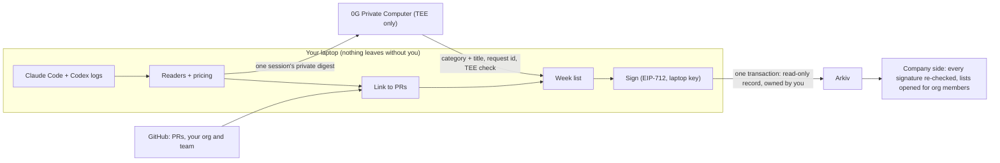

# Receipts

**What did your AI spend get done?**

AI tools make it easy to spend a lot and hard to say what came out of it, and token leaderboards reward burning tokens, not getting things done. Receipts gives a company the answer, one signed weekly receipt per person. Each employee runs it on their laptop, where it reads their Claude Code and Codex sessions and writes down what they got done:

> **Built** the team spend dashboard and the API quickstart. **Fixed** the double charge on retry. **Figured out** how settlement batching works. 7 AI sessions, Claude Code + Codex. **5 things done.**

A private AI on **0G** writes the list from the sessions, paid from the employee's own 0G credits (**Sign in with 0G**). It runs inside a hardware enclave (TEE) whose signature we check on every answer, so prompts are never sent to an ordinary AI API. The employee reviews what the company will see, signs it with a key made on their laptop, and sends it to the company on **Arkiv**, where it becomes a read-only record that they own. The company signs in with GitHub and sees everyone's signed list, the pull requests behind it and the totals. Never prompts.

## Who it is for

| | Who | Where | What they do |
|---|---|---|---|
| **My week** | each employee | their laptop, `/me` | Set up once (GitHub, join the company, Sign in with 0G, read logs). Every week: write, sign, send |
| **Company** | leads and managers | anywhere, `/company` | Sign in with GitHub, see everyone's week by team and person, every PR, where the money went. Whoever runs it sets up the wallet, the company key and Swarm once (Company, Setup) |
| **For fun** (side product) | anyone | `/wrapped` | AI Wrapped: how you talk to AI, shared as a card. Nothing to do with receipts, never sent to a company |

Anyone with a link can check a shared receipt (`/r/<key>`, `/verify`). To look around, open `/demo` and pick who you want to be at the demo company.

Built at ETHGlobal Mumbai (Nov 5 to 7, 2026).

## How it works (the employee's week)

1. **Read your logs.** Claude Code (`~/.claude/projects`, with subagents) and Codex (`~/.codex/sessions`) already log every session. Receipts prices every AI call from its token counts and checks it against Claude Code's own cost tracker (within 2% on real logs). Nothing leaves the laptop.
2. **Link the work.** With your GitHub token it finds the pull requests and commits each session turned into (PR links and commits in the log, branch, files), and what happened to them.
3. **Write.** Only when you click **Write my week**, after **Sign in with 0G**: every private AI call is paid from your own 0G account (your iAI daily credits or a top-up), about a cent a week, and the page shows your credits going down. Each session goes to a private AI on the **0G Private Computer** (TEE-only "private" mode): what you asked, what the AI said at the end, tool counts, the GitHub outcome and the cost. It answers with one line: a category (**Built, Fixed, Figured out, Researched, Wrote, Planned, Wasted**) and a short title. One more call sees only those lines and merges them into your list, plus one sentence about the week. Every answer's TEE signature is checked by the router and again by us. Until then, simple rules draft the list.
4. **Sign and send.** The receipt is the whole week as the AI wrote it: nothing can be left out or edited. Sign it with a key made on your laptop (no wallet needed). The signature covers the list, the PRs and every number, including how efficient the week was: idea to code, code to commit, commit to PR and PR to merge, the PR funnel, and waste by reason (plans nobody acted on, questions left hanging, loops, code that never shipped). Sending writes it to Arkiv in one transaction that creates a **read-only** record and hands its **ownership to you**; the company wallet only pays gas. Your company is your GitHub org and your team is your GitHub team: you join it once in My week, Setup, from your own GitHub teams.

On the author's own logs this week: 9 sessions, 9 private AI calls plus 1 weekly call on 0G, all TEE verified, about 20 seconds and under $0.01 in total.

## For fun: AI Wrapped (a separate side product)

One page, `/wrapped`, for anyone, coder or not. It has nothing to do with receipts and is never sent to a company.

`/wrapped` shows how you talk to AI: your AI personality (The Overthinker, The Brain Dumper, The 2 a.m. Philosopher, The Most Polite Human Alive...) and how much time went into overthinking, treating the AI as a therapist, student mode, just saying hi, "yes, go ahead", rage moments and brain dumps, plus your AI clock, streaks and fun facts. It works on your Claude Code and Codex logs, or on a **ChatGPT or Claude.ai data export**, which is read in your browser and never uploaded. Simple rules count everything, with no AI. The share card carries numbers only: share it from your device's share sheet, post it on X, or download it. **Roast me** optionally sends those numbers (never your messages) to the private AI on 0G for one playful line, about $0.0003, paid with Sign in with 0G. Details: [architecture/wrapped.md](architecture/wrapped.md).

## Run it

Needs Node 20+ and a GitHub login (`gh auth login`) or a `GITHUB_TOKEN`.

```bash
cd web
npm install
```

```bash
npm run receipts -- scan
```

```bash
npm run dev
```

Open **http://localhost:3000** (use `localhost`, not 127.0.0.1: "Sign in with 0G" only works on that address). The front door has the two sides: **Open my week** (the employee, on this laptop: set up once, then write, review, sign, send) and **Open the company page**. **Try the demo** lets you pick a role at the demo company Acme (12 people, synthetic data, safe to show on screen): its lead, an engineer, someone with a public link, or just for fun. A banner stays on top until you leave the demo.

Other commands (`npm run receipts -- <command>`):

| Command | What it does |
|---|---|
| `scan [--days 30] [--no-survival]` | Read logs and link to GitHub (rules only, no AI) |
| `write [2026-W45] [--demo]` | Have the private AI on 0G write a week with the app's own key (`ZG_API_KEY`); the web app uses Sign in with 0G instead |
| `week [2026-W45] [--demo]` | Print a week's list |
| `sign 2026-W45` | Sign that week's receipt |
| `team <id> "Name"`, `org <id> "Name"` | Set the team and company your receipts go to (the same as joining in My week, Setup) |
| `share 2026-W45` | Publish a signed receipt to Arkiv |
| `publish-demo` | Publish the demo company's signed receipts to Arkiv |
| `arkiv [team]` | Read a team's shared receipts back from Arkiv |
| `doctor` | Show which keys are set |

## Keys

Put them in `web/.env.local` (see `web/.env.example`). Everything is optional: without keys the app still reads logs, links PRs, writes the list with rules, and signs.

| Variable | Where to get it | Used for |
|---|---|---|
| `GITHUB_TOKEN` | GitHub settings, or nothing if `gh auth login` is done | PRs, your GitHub login, org and team |
| `NEXT_PUBLIC_PRIVY_APP_ID` | 0G's Privy app (default `cmn5w697g01xp0bl80c8dskc8`) | "Sign in with 0G": the web app pays every private AI call from your own 0G credits |
| `ZG_API_KEY` | https://pc.0g.ai, Dashboard, API Keys | Only the command line (`write`, `judge`), for developers or if 0G sign-in is down |
| `ARKIV_PRIVATE_KEY` | A throwaway key funded with tGLM at https://hub.arkiv.network/faucet | The wallet that pays the fee for each receipt (and, unless `COMPANY_PRIVATE_KEY` is set, the company key that opens the lists) |
| `COMPANY_PRIVATE_KEY` / `COMPANY_PUBLIC_KEY` | Any secp256k1 key | The company key that opens the lists (company copy only); employees get only the public key. Company, Setup shows what to hand out |
| `ARKIV_ACCESS_KEY` | https://hub.arkiv.network/access-keys | Higher Arkiv rate limits (recommended) |
| `SWARM_API_URL`, `SWARM_GATEWAY_URL`, `SWARM_POSTAGE_BATCH_ID` | The free Swarm testnet gateway (see `web/.env.example`), or your own Bee node and batch | The encrypted weeks on Swarm |
| `GITHUB_CLIENT_ID`, `GITHUB_CLIENT_SECRET` | A GitHub OAuth App, callback `http://localhost:3000/api/auth/callback` | "Sign in with GitHub" on the company side (on the laptop, its GitHub login counts too) |

## Architecture



Module by module, with the reasons behind each decision: [architecture/](architecture/overview.md).

## Partner tracks

### 0G: Build with 0G Private Computer

The private AI is the product's core: to say what you got done, it has to read what you asked and what the AI answered. Receipts never sends that to an ordinary AI API. Every call goes to the 0G router with `X-0G-Provider-Trust-Mode: private` (only providers running the model inside a TEE may answer) and `verify_tee: true`, and we re-check each TEE signature ourselves with the 0G SDK (`processResponse`) against the signer registered on 0G mainnet. In the web app every call is paid with **Sign in with 0G** (0G's Privy app, then `/v1/auth/privy`): the employee signs in with their 0G account as part of setup, and Write my week, the private review and Roast me spend their own daily credits; the page shows the balance (in 0G) before and after, and what the call cost. Every week links to **0G's own TEE check** of the provider that wrote it (`/proof/0g/<provider>`: 0G's router publishes its attestation verdicts per provider), the provider on 0G ChainScan, and your calls on pc.0g.ai. Default model `0gm-1.0-35b-a3b-sia` with thinking off (about 2 seconds a call), falling back to `glm-5.3` when its provider is down. Each result keeps the 0G **request id**, provider, TEE checks, cost and hashes of exactly what was sent and returned; they go into the signed receipt as Merkle leaves. The browser makes the calls with the person's 0G session; the laptop's server builds the messages and keeps the results (who paid is kept too). The app's own key is only used by the command line.

**What breaks if 0G is removed:** the AI that writes the list. Without a private computer we would have to send prompts to an ordinary API, which we refuse to do, so the list falls back to rules that name things after PR titles and cannot tell research from a dead end.

Code: `web/src/lib/receipts/judge-core.ts`, `judge.ts`, `week.ts`, `web/src/components/zero-g.tsx`, `web/src/lib/zerog-tasks.ts`.

### Arkiv: Build on Arkiv (from scratch), with the Arkiv + Swarm bonus

Every receipt an employee sends is an Arkiv entity (schema `receipts-ethglobal-mumbai.receipt.v2`, Arkiv testnet Rabdi, chain `7794095`, `@arkiv-network/sdk` 1.0.1). It is created **read-only** and handed to the person who signed it in the same transaction, with indexed org, team, week, signer, GitHub login and numbers, the signed JSON as payload, and an expiry of 120 days. The company wallet only pays the fee: nobody can change a receipt, and only the employee can delete it or keep it longer. The company side reads them back with one query and re-verifies every signature, so it works without our server and ignores anything unsigned.

**Swarm:** the full week (list, PRs, AI records) is encrypted on the laptop and stored on Swarm; the public Arkiv record keeps only the signed totals, the Swarm reference (`swarm`), and a pointer sealed to the company's key (`sealed`), so only the company can open the list. `/proof/swarm/<ref>` fetches the encrypted file from Swarm live and, for members of the company, checks it against the SHA-256 sealed in the Arkiv record. See [arkiv/swarm.md](arkiv/swarm.md).

Features people see that read Arkiv: the company side (`/company`, Teams, People, Pull requests), a shared receipt (`/r/<entity key>`) and Check a receipt (`/verify`). Every receipt in the app links to its record and transaction on the Arkiv explorer ("Check it yourself").

- **Wallet that wrote the entities** (the demo company's wallet; it pays the fee and hands every record to its signer): `0x09351DC0A6AFa87da28D00914fE87373C5C82747`. The records are owned by 12 signer addresses, one per person.
- **Live data (checked Nov 7):** 89 receipt entities for the demo company Acme (12 people, 5 weeks; 60 with the full list on Arkiv, 29 sealed with the list on Swarm).
- **Example entities:** a sealed v3 week [`0xea50…9ca6`](https://rabdi.explorer.arkiv.network/entity/0xea50b76a7c871350d819fac561481bfb8070e3da040b3828e9369d0d99cb9ca6) (Swarm [`6483e194…eb75`](https://api.gateway.testnet.ethswarm.org/bytes/6483e19496c5b16f1f7b35da826f42ff140caedb31732c4e7a7fa90d597eeb75), ciphertext), a plain week [`0xf2d3…16f7`](https://rabdi.explorer.arkiv.network/entity/0xf2d3453735d6a71bf660ac37344e42f827929205930cfbcb5ef4297513e416f7), and every record the wallet wrote: [the wallet on the Arkiv explorer](https://rabdi.explorer.arkiv.network/address/0x09351DC0A6AFa87da28D00914fE87373C5C82747).

**One query to run.** Acme's receipts for week 45 (37 entities):

```
arkiv.schema = str('receipts-ethglobal-mumbai.receipt.v2') AND type = str('receipt') AND org = str('acme') AND period = str('2026-W45')
```

Arkiv's public endpoint refuses anonymous queries (`ANON_COST_LIMITED`), so use a free access key from https://hub.arkiv.network/access-keys, which goes at the end of the RPC address:

```bash
curl -s https://rpc.rabdi.db-chain.testnet.arkiv.network/<ACCESS_KEY> -H 'Content-Type: application/json' -d "{\"jsonrpc\":\"2.0\",\"id\":1,\"method\":\"arkiv_query\",\"params\":[\"arkiv.schema = str('receipts-ethglobal-mumbai.receipt.v2') AND type = str('receipt') AND org = str('acme') AND period = str('2026-W45')\",{\"select\":{\"key\":true,\"owner\":true},\"limit\":\"0x64\"}]}"
```

More queries (sealed weeks, one team, big weeks that went in circles) are in [arkiv/schema.md](arkiv/schema.md). The same data, read by the app: open `/demo` and be Acme's lead.

**Judging files:** [schema.md](arkiv/schema.md), [friction.md](arkiv/friction.md) (Arkiv feedback), [reach.md](arkiv/reach.md), [why-arkiv.md](arkiv/why-arkiv.md), [how-you-use-arkiv.md](arkiv/how-you-use-arkiv.md) (who can edit each entity, and when it expires), [swarm.md](arkiv/swarm.md) (the bonus).

### Ethereum Foundation: Best CROPS App

See the CROPS section below. The lead property is **Private**.

### Optional: Chainlink CRE monthly scoring job

Built but not submitted (three partners max). See [cre/README.md](cre/README.md).

## CROPS

- **C (censorship resistance).** There is no Receipts server. The app runs on your laptop and depends only on GitHub (your token), the 0G router (optional) and an Arkiv RPC. If this project disappears, your receipts are still JSON files signed with your key that anyone can verify with a standard EIP-712 library, and shared ones stay on Arkiv, owned by you, until they expire.
- **O (open source).** MIT license. Everything builds and runs from this repo with `npm install`.
- **P (private).** Raw logs never leave the laptop. When you ask for your week to be written, a trimmed digest of each session (prompts cut short, the AI's last answers) goes to 0G's private computer, where the model runs inside a TEE and every answer's TEE signature is checked. Those requests are not end-to-end sealed today: they travel over HTTPS through 0G's router, which could read them in transit, so 0G's router is a trusted party, like any API provider. Session titles and file names stay in `~/.receipts`. GitHub learns which PRs you look up (it already has them). Arkiv (public) only gets what you share: the signed list, PR titles and links, and totals. The week card is drawn locally. No trackers or analytics.
- **S (secure).** Receipts are signed with a key that never leaves `~/.receipts` (mode 0600). Any change to a number breaks the signature; any change to an item, PR or AI record breaks its Merkle root. Shared records are read-only and owned by the signer, and re-verified on read. The app only listens on 127.0.0.1, only answers requests addressed to localhost, and rejects cross-site requests, so another website cannot make it sign, publish or spend. Trust assumptions: 0G's router (it can see requests in transit, since they are not end-to-end sealed) and its TEE attestation, GitHub's API answers, and that the Arkiv testnet and Swarm keep data until expiry.

## What leaves your laptop

| Data | Where it goes | Who can read it |
|---|---|---|
| Raw logs and prompts | Nowhere | Only you |
| Session titles, file names | `~/.receipts` on your laptop | Only you |
| One session's trimmed prompts and the AI's last answers, when you click Write my week | 0G Private Computer, private mode (model in a TEE) | The model in the TEE, and 0G's router in transit (not end-to-end sealed today) |
| The list's titles, for the weekly summary | The same private model | The same |
| PR numbers, repo names | GitHub API with your token | GitHub |
| Your AI Wrapped card (numbers only) | Nowhere, unless you post it | Whoever you show it to |
| Your messages, for AI Wrapped | Nowhere: counted on the laptop (logs) or in the browser tab (ChatGPT and Claude.ai exports) | Only you |
| The Wrapped numbers, when you click Roast me | 0G Private Computer, private mode (numbers only, never messages) | The model in the TEE, and 0G's router in transit |
| Your signed totals, when you send your receipt | Arkiv testnet, read-only, owned by you | Anyone |
| Your list, PRs and AI records, when you send your receipt | Swarm, encrypted on your laptop; the key is sealed to your company's key on Arkiv | Members of your company |

## Honest limits

- Linking is best effort. Sessions in folders that were deleted or moved often cannot be linked to a PR; the AI still writes what they got.
- Cost is the API list price of the tokens in your logs. On a subscription plan your real bill is different.
- The GitHub login inside a receipt is claimed by the signer; the company page shows the signing address next to it. Joining a company is checked against your GitHub teams, but nothing yet proves to the company that a signing key belongs to that login.
- 0G requests are not end-to-end sealed today (0G reports `X-0G-E2EE: none` for our model), so 0G's router could read them in transit. The model itself runs in a TEE and its signature is checked on every answer.
- "Sign in with 0G" uses 0G's own Privy app, which only allows `http://localhost:3000`, so the private AI only runs on the laptop; a hosted copy shows the demo's weeks, already written by 0G. It needs a real login, so it was built and wired but not tested end to end by us. If it fails, `npm run receipts -- write` writes the week with the app's own key.

## AI usage

This project was built with heavy help from Claude Code. See [docs/AI_USAGE.md](docs/AI_USAGE.md) for what was generated, by what, and from which brief ([docs/brief.md](docs/brief.md)).

## License

MIT. See [LICENSE](LICENSE).
