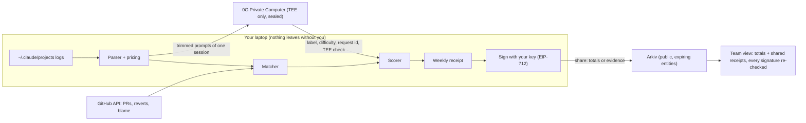

# Receipts

See what your AI coding spend actually bought.

Companies hand out big AI budgets, then rank people by how many tokens they burn. Those leaderboards get gamed, and tokens are a small part of what a pull request costs anyway. Receipts flips it: for every Claude Code session it shows the cost, what the session turned into on GitHub (merged, reverted, still alive 30 days later), and a label from a private AI judge. Every week you get a receipt you sign and own, like:

> **$2,140 bought 14 shipped tasks, 91% still alive.**

It is your evidence at review time. Managers only see team totals and the receipts people choose to share. Never prompts.

Built at ETHGlobal Mumbai (Nov 5 to 7, 2026).

## What it does

1. **Cost.** Reads Claude Code's own logs in `~/.claude/projects` (including subagents), prices every API call from its token counts, and cross-checks Claude Code's own cost tracker.
2. **Outcome.** Asks GitHub what happened to the work: merged, open, closed, or reverted later. For merged work it runs `git blame` (GitHub GraphQL) on the base branch 30 days after the merge and counts how many added lines are still there.
3. **Match.** Links sessions to pull requests using the PR links and commits Claude Code records, the branch the session worked on, and files edited around the same time. Every link keeps its reason and a confidence.
4. **Judge.** Labels each session **Shipped, Learned, Looped, Abandoned or Overkill** and rates its difficulty 1 to 5. Offline rules always run. The private judge runs on **0G Private Computer** in private mode, so the prompts are only read inside a hardware enclave (TEE).
5. **Score.** Kept Work per Dollar. A shipped task counts as the share of its code still alive. Cost per kept task is only compared between tasks of the same difficulty, never across people.
6. **Sign and share.** You sign the weekly receipt (EIP-712) with your own key. Sharing writes it to **Arkiv**, either totals only or with PR links as evidence. The team view reads it back from Arkiv and checks every signature.

On the author's own logs (last 30 days, 49 sessions): the parser's price matches Claude Code's own tracker within 2%, 27 of 49 sessions link to 39 pull requests or commits, and the first real receipt read "$684 bought 30 shipped tasks, 87% still alive".

## Run it

Needs Node 20+ and a GitHub login (`gh auth login`) or a `GITHUB_TOKEN`.

```bash
cd web
npm install
```

```bash
npm run receipts -- scan
```

```bash
npm run dev
```

Open http://localhost:3000. Use the switch in the top right to flip between **My logs** and the **Demo team** (a fictional team with synthetic data, safe to show on screen).

Other commands (`npm run receipts -- <command>`):

| Command | What it does |
|---|---|
| `scan [--days 30] [--no-survival]` | Read logs, link to GitHub, label, save to `~/.receipts` |
| `judge [--limit 5]` | Re-label sessions with the private 0G judge |
| `week 2026-W45 [--demo]` | Print one week's summary |
| `sign 2026-W45` | Sign that week's receipt with `RECEIPTS_SIGNER_KEY` |
| `team <id> "Name"` | Set the team id used when sharing |
| `share 2026-W45 [--level full]` | Publish a signed receipt to Arkiv |
| `publish-demo` | Publish the demo team's signed receipts to Arkiv |
| `arkiv [team]` | Read a team's shared receipts back from Arkiv |
| `doctor` | Show which keys are set |

## Keys

Copy `web/.env.example` to `web/.env.local`. Everything is optional: without keys the app still scans, links, labels with offline rules, and signs demo receipts.

| Variable | Where to get it | Used for |
|---|---|---|
| `GITHUB_TOKEN` | GitHub settings, or nothing if `gh auth login` is done | PR outcomes and blame |
| `ZG_API_KEY` | https://pc.0g.ai, Dashboard, API Keys (teams get hackathon credits) | The private judge |
| `ARKIV_PRIVATE_KEY` | Any throwaway key, funded with tGLM at https://hub.arkiv.network/faucet | Sharing receipts |
| `ARKIV_ACCESS_KEY` | https://hub.arkiv.network/access-keys | Higher Arkiv RPC limits (optional) |
| `RECEIPTS_SIGNER_KEY` | Any throwaway key | One-click signing without a browser wallet |

## Architecture



| Piece | Code |
|---|---|
| Log parser and pricing | `web/src/lib/receipts/parse.ts`, `pricing.ts` |
| GitHub client, outcomes, survival | `web/src/lib/receipts/github.ts`, `outcomes.ts` |
| Session to PR matching | `web/src/lib/receipts/match.ts` |
| Offline judge rules | `web/src/lib/receipts/heuristics.ts` |
| Private judge on 0G | `web/src/lib/receipts/judge.ts` |
| Scoring | `web/src/lib/receipts/score.ts` |
| Receipts, EIP-712, Merkle evidence | `web/src/lib/receipts/receipt.ts` |
| Arkiv read and write | `web/src/lib/receipts/arkiv.ts` |
| Web app | `web/src/app` |
| CLI | `web/scripts/receipts.ts` |
| Monthly scoring job (Chainlink CRE, optional) | `cre/receipts-monthly/main.ts` |
| On-chain team scores (CRE consumer, optional) | `contracts/src/TeamScoreboard.sol` |

## Partner tracks

### 0G: Build with 0G Private Computer

The judge is the core of the product, and it has to read prompts to be any good. Receipts never sends prompts to a normal AI API. Each judge call goes to the 0G router with `X-0G-Provider-Trust-Mode: private`, so only a provider whose model runs inside a TEE can serve it (model `0gm-1.0-35b-a3b`), and the request is sealed end to end. We ask the router to verify the TEE signature (`verify_tee`), and we also check it ourselves with the 0G SDK (`processResponse`) against the signer registered on 0G mainnet. Every judgement keeps the 0G **request id**, provider, chat id, whether it was sealed and verified, and hashes of exactly what was sent and returned. Those go into the signed receipt as Merkle leaves.

**What breaks if 0G is removed:** the AI judge. Without 0G's private computer we would have to send prompts to an ordinary API, which we refuse to do, so every session falls back to rules that cannot tell real learning from a dead end or see why a session went in circles.

Code: `web/src/lib/receipts/judge.ts` (`chat`, `selfVerifyTee`, `judgeSessions`), UI: "Ask the private judge" on the home page and each session page, request ids on `/sessions/[id]`.

### Arkiv: Build on Arkiv

Shared receipts are Arkiv entities (schema `receipts-ethglobal-mumbai.receipt.v1` on the Rabdi testnet). The team page reads them back with a query and re-verifies every signature, so it works without our server and ignores anything unsigned. Details in [`/arkiv`](arkiv/): [schema](arkiv/schema.md), [how we use it](arkiv/how-you-use-arkiv.md), [why Arkiv](arkiv/why-arkiv.md), [reach](arkiv/reach.md), [friction log](arkiv/friction.md).

- Writer wallet: _add after funding (run `npm run receipts -- doctor`)_
- Query judges can run:

```
arkiv.schema = str('receipts-ethglobal-mumbai.receipt.v1') AND type = str('receipt') AND team = str('acme-payments')
```

### Ethereum Foundation: Best CROPS App

See the CROPS section below. The lead property is **Private**.

### Optional: Chainlink CRE monthly scoring job

Built but not submitted (three partners max). A CRE workflow reads a team's shared receipts straight from Arkiv, re-checks the evidence PRs on GitHub, takes the median across DON nodes and writes a verified monthly team score to `TeamScoreboard` on Arc testnet. See [cre/README.md](cre/README.md). Swap it in for one of the three tracks if you prefer; it needs `cre login` to simulate.

## CROPS

- **C (censorship resistance).** There is no Receipts server. The app runs on your machine. It depends on the GitHub API (your own token), the 0G router (optional, the offline judge works without it) and an Arkiv RPC (set `ARKIV_RPC_URL` to any Rabdi endpoint). If this project disappears, your receipts are still JSON files signed with your key that anyone can verify with a standard EIP-712 library, and shared receipts stay readable on Arkiv until they expire (we set 120 days).
- **O (open source).** MIT license. Everything builds and runs from this repo with `npm install`, no hosted service of ours involved.
- **P (private).** Raw logs and prompts never leave the laptop. Session titles and file names stay in `~/.receipts`. GitHub learns which PRs you look up (it already has them). The 0G router learns the model name, sizes and timing, and only a TEE-hosted model reads the trimmed prompts of a session you choose to judge. Arkiv (public) only gets what you share: signed totals, or totals plus PR links. The browser makes no third-party requests and there are no trackers or analytics (fonts are self-hosted by Next.js).
- **S (secure).** Receipts are signed with your own key (browser wallet, or a local key in `.env.local` that never leaves the machine). Any change to a signed number breaks the signature, and any change to evidence breaks its Merkle root. Shared receipts are re-verified on read, so writing junk to the same Arkiv schema does nothing. Local data files are created with owner-only permissions. The app only listens on 127.0.0.1, only answers requests addressed to localhost (no DNS rebinding), and its API rejects cross-site requests, so another website cannot make it sign or publish anything. Trust assumptions: the 0G TEE attestation (Intel TDX plus GPU TEE), GitHub's API answers, and that the Arkiv testnet keeps data until expiry.

## What leaves your laptop

| Data | Where it goes | Who can read it |
|---|---|---|
| Raw logs and prompts | Nowhere | Only you |
| Session titles, file names | `~/.receipts` on your laptop | Only you |
| Trimmed prompts of one session, when you ask the private judge | 0G Private Computer, private mode, sealed | The enclave (router sees model, size, timing) |
| PR numbers, repo names | GitHub API with your token | GitHub |
| Signed weekly totals, when you share | Arkiv testnet | Anyone |
| PR links and per-task cost, when you share with evidence | Arkiv, inside the signed receipt | Anyone |

## Definitions

- **Shipped task**: a merged PR (or a commit pushed straight to the default branch) linked to the session. A task reverted later still counts as shipped, at 0% alive.
- **Still alive**: lines added by shipped tasks that are still attributed to them by blame, measured 30 days after merge (or today, marked "so far").
- **Kept work**: the sum of each shipped task's alive share. Reverted, closed or unmerged work counts 0.
- **Waste**: spend on Looped and Abandoned sessions, plus the part of Overkill spend above what similar small tasks cost.
- **Open**: not judged yet (open PR, fresh edits, or a folder with no GitHub repo we could find). Never counted as waste.

## Honest limits

- Matching is best effort. Sessions in folders that were deleted or moved (old worktrees, scratch folders) often cannot be linked.
- Survival samples the 8 files with the most added lines per task.
- Cost is the Claude API list price of the tokens in your logs. On a subscription plan your real bill is different; the number shows what the work would cost at API prices.
- The offline rules are conservative. The private judge is what tells Learned from Abandoned and spots loops reliably.

## AI usage

This project was built with heavy help from Claude Code. See [docs/AI_USAGE.md](docs/AI_USAGE.md) for what was generated, by what, and from which brief ([docs/brief.md](docs/brief.md)).

## License

MIT. See [LICENSE](LICENSE).
