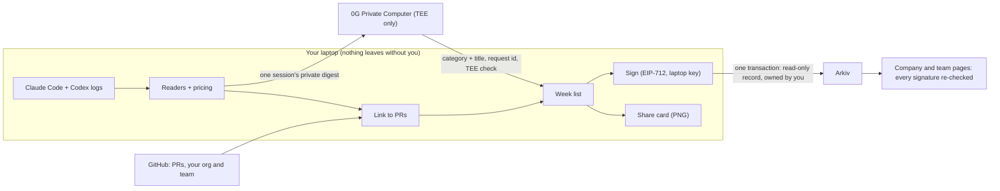

# Receipts

**What did you get done this week?**

AI tools make it easy to spend a lot and hard to say what came out of it, and token leaderboards reward burning tokens, not getting things done. Receipts reads your Claude Code and Codex sessions on your laptop and answers the question for you:

> **Built** the team spend dashboard and the API quickstart. **Fixed** the double charge on retry. **Figured out** how settlement batching works. 7 AI sessions, Claude Code + Codex. **5 things done.**

A private AI on **0G** writes the list from your sessions. It runs inside a hardware enclave (TEE) whose signature we check on every answer, so your prompts are never sent to an ordinary AI API. You can post the list as a card, or sign it and share it with your company on **Arkiv**, where it becomes a read-only record that you own. Your company sees everyone's signed list, the pull requests behind it and the totals. Never prompts.

Built at ETHGlobal Mumbai (Nov 5 to 7, 2026).

## How it works

1. **Read your logs.** Claude Code (`~/.claude/projects`, with subagents) and Codex (`~/.codex/sessions`) already log every session. Receipts prices every AI call from its token counts and checks it against Claude Code's own cost tracker (within 2% on real logs). Nothing leaves the laptop.
2. **Link the work.** With your GitHub token it finds the pull requests and commits each session turned into (PR links and commits in the log, branch, files), and what happened to them.
3. **Write what you got.** Only when you click **Write my week**. Each session goes to a private AI on the **0G Private Computer** (TEE-only "private" mode): what you asked, what the AI said at the end, tool counts, the GitHub outcome and the cost. It answers with one line: a category (**Built, Fixed, Figured out, Researched, Wrote, Planned, Wasted**) and a short title. One more call sees only those lines and merges them into your list, plus one sentence about the week. Every answer's TEE signature is checked by the router and again by us. Without a key, simple rules write the list.
4. **Share it for fun.** Tick and edit the lines, then download a card (1080x1350), copy it, post it on X or save it as a PDF. Cost is hidden unless you turn it on. Nothing is uploaded.
5. **Share it with your company.** Sign the week with a key made on your laptop (no wallet needed). The signature covers the list, the PRs and every number. Sharing writes it to Arkiv in one transaction that creates a **read-only** record and hands its **ownership to you**; the company wallet only pays gas. Your company is your GitHub org and your team is your GitHub team.

On the author's own logs this week: 9 sessions, 9 private AI calls plus 1 weekly call on 0G, all TEE verified, about 20 seconds and under $0.01 in total.

## Run it

Needs Node 20+ and a GitHub login (`gh auth login`) or a `GITHUB_TOKEN`.

```bash
cd web
npm install
```

```bash
npm run receipts -- scan
```

```bash
npm run dev
```

Open **http://localhost:3000** (use `localhost`, not 127.0.0.1: "Sign in with 0G" only works on that address). Use the switch in the top right to flip between **My data** and the **Demo** company (Acme, 12 people, synthetic data, safe to show on screen).

Other commands (`npm run receipts -- <command>`):

| Command | What it does |
|---|---|
| `scan [--days 30] [--no-survival]` | Read logs and link to GitHub (rules only, no AI) |
| `write [2026-W45] [--demo]` | Have the private AI on 0G write a week |
| `week [2026-W45] [--demo]` | Print a week's list |
| `sign 2026-W45` | Sign that week's receipt |
| `team <id> "Name"`, `org <id> "Name"` | Override the team and company used when sharing (default: your GitHub team) |
| `share 2026-W45` | Publish a signed receipt to Arkiv |
| `publish-demo` | Publish the demo company's signed receipts to Arkiv |
| `arkiv [team]` | Read a team's shared receipts back from Arkiv |
| `doctor` | Show which keys are set |

## Keys

Put them in `web/.env.local` (see `web/.env.example`). Everything is optional: without keys the app still reads logs, links PRs, writes the list with rules, signs, and makes cards.

| Variable | Where to get it | Used for |
|---|---|---|
| `GITHUB_TOKEN` | GitHub settings, or nothing if `gh auth login` is done | PRs, your GitHub login, org and team |
| `ZG_API_KEY` | https://pc.0g.ai, Dashboard, API Keys | The private AI (or skip it and use "Sign in with 0G") |
| `NEXT_PUBLIC_PRIVY_APP_ID` | 0G's Privy app (default `cmn5w697g01xp0bl80c8dskc8`) | "Sign in with 0G" to pay from your own 0G credits |
| `ARKIV_PRIVATE_KEY` | A throwaway key funded with tGLM at https://hub.arkiv.network/faucet | The company wallet that pays for shared receipts |
| `ARKIV_ACCESS_KEY` | https://hub.arkiv.network/access-keys | Higher Arkiv rate limits (recommended) |
| `SWARM_API_URL`, `SWARM_GATEWAY_URL`, `SWARM_POSTAGE_BATCH_ID` | The free Swarm testnet gateway (see `web/.env.example`), or your own Bee node and batch | Private weeks and public cards on Swarm |
| `GITHUB_CLIENT_ID`, `GITHUB_CLIENT_SECRET` | A GitHub OAuth App, callback `http://localhost:3000/api/auth/callback` | "Sign in with GitHub" for the company view |

## Architecture



Module by module, with the reasons behind each decision: [architecture/](architecture/overview.md).

## Partner tracks

### 0G: Build with 0G Private Computer

The private AI is the product's core: to say what you got done, it has to read what you asked and what the AI answered. Receipts never sends that to an ordinary AI API. Every call goes to the 0G router with `X-0G-Provider-Trust-Mode: private` (only providers running the model inside a TEE may answer) and `verify_tee: true`, and we re-check each TEE signature ourselves with the 0G SDK (`processResponse`) against the signer registered on 0G mainnet. Default model `0gm-1.0-35b-a3b-sia` with thinking off (about 2 seconds a call), falling back to `glm-5.3` when its provider is down. Each result keeps the 0G **request id**, provider, TEE checks, cost and hashes of exactly what was sent and returned; they go into the signed receipt as Merkle leaves. **Sign in with 0G** (0G's Privy app, then `/v1/auth/privy`) lets each person pay from their own 0G credits: the browser makes the calls, the laptop's server builds the messages and keeps the results.

**What breaks if 0G is removed:** the AI that writes the list. Without a private computer we would have to send prompts to an ordinary API, which we refuse to do, so the list falls back to rules that name things after PR titles and cannot tell research from a dead end.

Code: `web/src/lib/receipts/judge-core.ts`, `judge.ts`, `week.ts`, `web/src/components/zero-g-pay.tsx`.

### Arkiv: Build on Arkiv (+ Swarm bonus)

Shared weeks are Arkiv entities (schema `receipts-ethglobal-mumbai.receipt.v2` on the Rabdi testnet), created **read-only** and handed to the signer in the same transaction, with indexed org, team, week, signer, GitHub login and numbers, and the signed JSON as payload, expiring after 120 days. The company and team pages read them back with one query and re-verify every signature, so they work without our server and ignore anything unsigned. Details in [`/arkiv`](arkiv/).

**Swarm:** the full week (list, PRs, AI records) is encrypted on the laptop and stored on Swarm; the public Arkiv record keeps only the signed totals, the Swarm reference, and a pointer sealed to the company's key, so only the company can open the list. Public cards are stored on Swarm and listed on Arkiv (schema `receipts-ethglobal-mumbai.card.v1`), shown on `/wall`. See [arkiv/swarm.md](arkiv/swarm.md).

- **Writer wallet** (the demo company's wallet, pays gas; every record is handed to its signer): `0x09351DC0A6AFa87da28D00914fE87373C5C82747`
- **Live data:** 77 shared weeks for the demo company Acme (12 people, 5 weeks; week 45 for everyone is sealed on Swarm) and the public cards on the wall.
- **Example entities:** a sealed week [`0xb68e…735c`](https://rabdi.explorer.arkiv.network/entity/0xb68e90172784a003d42f4ebee3262bb00d4db637685c10de96f3bbae6391735c) (Swarm `46901a99…083e`), a plain week [`0xf2d3…16f7`](https://rabdi.explorer.arkiv.network/entity/0xf2d3453735d6a71bf660ac37344e42f827929205930cfbcb5ef4297513e416f7), a public card [`0xd478…3819`](https://rabdi.explorer.arkiv.network/entity/0xd4785a1b1487ae296e6c0ccc79a7f85a5254b1d2572d32da9979d8211afa3819) ([the card on Swarm](https://api.gateway.testnet.ethswarm.org/bzz/edca15e00de285fe548539a746674a8115b90a86c3f4aac494891bbfac475a38/)).

Queries you can run as is:

```
arkiv.schema = str('receipts-ethglobal-mumbai.receipt.v2') AND type = str('receipt') AND org = str('acme') AND period = str('2026-W45')
arkiv.schema = str('receipts-ethglobal-mumbai.receipt.v2') AND org = str('acme') AND level = str('sealed')
arkiv.schema = str('receipts-ethglobal-mumbai.card.v1') AND type = str('card') AND org = str('acme')
```

### Ethereum Foundation: Best CROPS App

See the CROPS section below. The lead property is **Private**.

### Optional: Chainlink CRE monthly scoring job

Built but not submitted (three partners max). See [cre/README.md](cre/README.md).

## CROPS

- **C (censorship resistance).** There is no Receipts server. The app runs on your laptop and depends only on GitHub (your token), the 0G router (optional) and an Arkiv RPC. If this project disappears, your receipts are still JSON files signed with your key that anyone can verify with a standard EIP-712 library, and shared ones stay on Arkiv, owned by you, until they expire.
- **O (open source).** MIT license. Everything builds and runs from this repo with `npm install`.
- **P (private).** Raw logs never leave the laptop. When you ask for your week to be written, a trimmed digest of each session (prompts cut short, the AI's last answers) goes to 0G's private computer, where the model runs inside a TEE and every answer's TEE signature is checked. Those requests are not end-to-end sealed today: they travel over HTTPS through 0G's router, which could read them in transit, so 0G's router is a trusted party, like any API provider. Session titles and file names stay in `~/.receipts`. GitHub learns which PRs you look up (it already has them). Arkiv (public) only gets what you share: the signed list, PR titles and links, and totals. The share card is drawn locally. No trackers or analytics.
- **S (secure).** Receipts are signed with a key that never leaves `~/.receipts` (mode 0600). Any change to a number breaks the signature; any change to an item, PR or AI record breaks its Merkle root. Shared records are read-only and owned by the signer, and re-verified on read. The app only listens on 127.0.0.1, only answers requests addressed to localhost, and rejects cross-site requests, so another website cannot make it sign, publish or spend. Trust assumptions: 0G's router (it can see requests in transit, since they are not end-to-end sealed) and its TEE attestation, GitHub's API answers, and that the Arkiv testnet and Swarm keep data until expiry.

## What leaves your laptop

| Data | Where it goes | Who can read it |
|---|---|---|
| Raw logs and prompts | Nowhere | Only you |
| Session titles, file names | `~/.receipts` on your laptop | Only you |
| One session's trimmed prompts and the AI's last answers, when you click Write my week | 0G Private Computer, private mode (model in a TEE) | The model in the TEE, and 0G's router in transit (not end-to-end sealed today) |
| The list's titles, for the weekly summary | The same private model | The same |
| PR numbers, repo names | GitHub API with your token | GitHub |
| The share card | Nowhere, unless you post it | Whoever you show it to |
| Your signed totals, when you share with your company | Arkiv testnet, read-only, owned by you | Anyone |
| Your list, PRs and AI records, when you share with your company | Swarm, encrypted on your laptop; the key is sealed to your company's key on Arkiv | Your company |
| A card you make public with Get a Swarm link | Swarm, listed on Arkiv | Anyone |

## Honest limits

- Linking is best effort. Sessions in folders that were deleted or moved often cannot be linked to a PR; the AI still writes what they got.
- Cost is the API list price of the tokens in your logs. On a subscription plan your real bill is different.
- The GitHub login inside a receipt is claimed by the signer; the company page shows the signing address next to it.
- 0G requests are not end-to-end sealed today (0G reports `X-0G-E2EE: none` for our model), so 0G's router could read them in transit. The model itself runs in a TEE and its signature is checked on every answer.
- "Sign in with 0G" uses 0G's own Privy app, which only allows `http://localhost:3000`. It needs a real login, so it was built and wired but not tested end to end by us.

## AI usage

This project was built with heavy help from Claude Code. See [docs/AI_USAGE.md](docs/AI_USAGE.md) for what was generated, by what, and from which brief ([docs/brief.md](docs/brief.md)).

## License

MIT. See [LICENSE](LICENSE).
